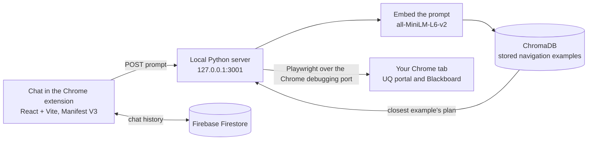

# UQ Agent

A Chrome extension that navigates the University of Queensland student portal for you. Type what you want in plain English, such as "COMP3710 announcements", and the agent opens the right page in your own browser.

Built by a team at the UQCS Hackathon 2025. This is a hackathon prototype, and it is not affiliated with or endorsed by the University of Queensland.

## Team

- [Akshat Saravanan](https://github.com/akshatmaheshwar)
- [Abhishek Tanguturi](https://github.com/abhishektang)
- [divyanshddn146](https://github.com/divyanshddn146)

## How it works



1. You type a request in the extension popup.
2. The extension sends it to a small Python server running on your machine.
3. The server converts the request into an embedding (`sentence-transformers`, `all-MiniLM-L6-v2`) and looks up the most similar stored example in a ChromaDB vector database. Each example is a short plan, for example "go to the course list, click the course, click Announcements".
4. Playwright connects to your already-open Chrome through its remote debugging port and carries out the plan.
5. Chat history is saved to Firebase so conversations survive closing the popup.

Things the automation does to cope with the portal's pages:

- Waits for the Angular app and the page to finish loading before each step.
- Finds buttons and links by their visible text using fuzzy matching (`fuzzywuzzy`), so small wording differences still match.
- Caches the selectors it has already found.
- Switches to new tabs when a click opens one.

## Setup

You need Python 3.10 or newer, Node.js 18 or newer, Google Chrome, and a Firebase project (Firestore enabled, and Anonymous sign-in enabled under Authentication).

### 1. Python server

```bash
python -m venv .venv
# Windows: .venv\Scripts\activate      macOS/Linux: source .venv/bin/activate
pip install -r requirements.txt
```

### 2. Extension

```bash
cd uq-agent-react
npm install
cp .env.example .env     # on Windows: copy .env.example .env
```

Open `.env` and fill in your Firebase web app settings (Firebase console, Project settings, Your apps). Then build:

```bash
npm run build
```

This creates `uq-agent-react/dist`.

### 3. Start Chrome with the debugging port

The server controls Chrome through its debugging port. Recent versions of Chrome only allow this with a separate profile, so give it its own data folder.

```bash
# Windows
"C:\Program Files\Google\Chrome\Application\chrome.exe" --remote-debugging-port=9222 --user-data-dir="%TEMP%\uq-agent-chrome"

# macOS
/Applications/Google\ Chrome.app/Contents/MacOS/Google\ Chrome --remote-debugging-port=9222 --user-data-dir=/tmp/uq-agent-chrome
```

In that Chrome window:

1. Open `chrome://extensions`, turn on Developer mode, choose Load unpacked, and select `uq-agent-react/dist`.
2. Sign in to `https://portal.my.uq.edu.au`.

### 4. Start the server

```bash
python vectorDBClicksIntegrated.py
```

The first start downloads the embedding model (about 90 MB) and builds the vector database, so it takes a moment. The server listens on `http://127.0.0.1:3001`.

### 5. Use it

Stay on the portal tab, click the UQ Agent icon, and type a request.

The stored examples in `vector_db.py` are written for a few specific courses (for example Artificial Intelligence, Pattern Recognition and Analysis, and Design Computing Studio 3). Requests similar to those examples work. For your own courses, add examples (see below).

## Adding your own examples

Open `vector_db.py` and add an entry to `get_examples()`:

```python
{
    "query": "COMP3710 announcements",
    "plan": {
        "steps": [
            {"action": "goto", "url": "https://learn.uq.edu.au/ultra/course"},
            {"action": "click", "element_description": "Pattern Recognition and Analysis"},
            {"action": "click", "element_description": "Announcements"}
        ]
    }
}
```

`element_description` is the visible text of the thing to click. Restart the server and the vector database is rebuilt from the list.

## Project structure

```
.
├── vectorDBClicksIntegrated.py   # The server: HTTP API, plan lookup, Playwright automation
├── vector_db.py                  # Vector database setup and the stored navigation examples
├── requirements.txt              # Python dependencies
├── Modelfile                     # Ollama model settings used by the early prototypes
├── experiments/                  # Earlier prototypes and test scripts (not used by the server)
└── uq-agent-react/               # The Chrome extension
    ├── public/manifest.json      # Extension manifest and permissions
    ├── src/                      # React popup (chat UI), content script, helpers
    ├── FirebaseConfig.js         # Firebase setup, reads settings from .env
    └── .env.example              # Firebase settings template
```

The `experiments/` folder holds earlier attempts: planning with a local language model through Ollama (`finalAgent.py`, `ClickTestUsingVLM.py`) and the first click-by-text tests. They are kept for reference.

## Current limitations

- It only knows what is in the stored examples. A request that is not close to any example may open the wrong page.
- The plan executor currently supports `goto` and `click` steps. Other step types (`hover`, `fill`, `type`, `select`, `press_enter`, `wait`) are defined but not wired up yet, and a few library examples use a `scrape` step that is not implemented.
- It needs a Chrome window started with the remote debugging port, as described above.
- Selectors depend on the text and layout of the portal, so a redesign can break plans.

## Security notes

- The server binds to `127.0.0.1` only, so other machines on your network cannot reach it. It currently allows requests from any website origin (CORS `*`). Before sharing this beyond a prototype, restrict that to the extension's own origin.
- Anyone who can reach the server can drive your signed-in browser, so keep it local and do not expose port 3001 or 9222 to a network.
- Firebase web settings identify your project and are not secrets, but your Firestore rules decide who can read and write data. Lock them down before using real data. `.env` is ignored by Git.

## Development

```bash
cd uq-agent-react
npm run lint       # check the code
npm run watch      # rebuild dist/ when files change
npm run server     # start the Python server from here
npm run dev        # watch and server together
```
